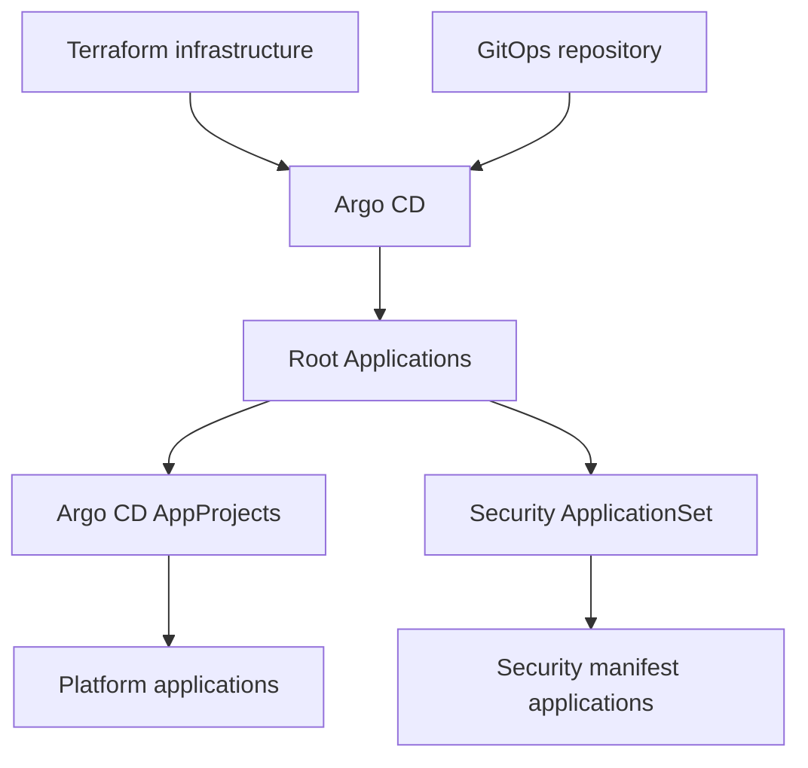
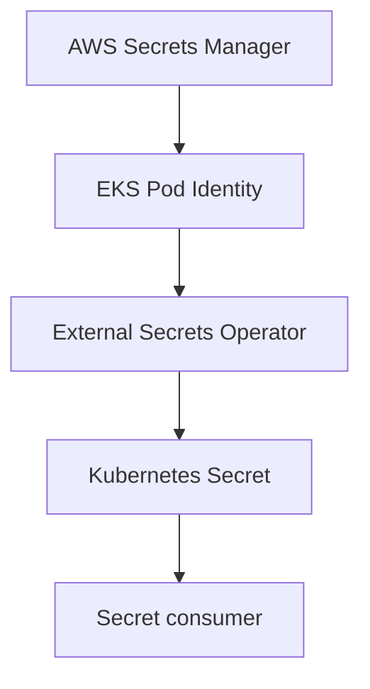

# Say When: EKS GitOps Platform

A GitOps repository for my AWS EKS DevSecOps home lab.

This project documents hands-on work with Kubernetes, Argo CD, Helm, cloud security, policy enforcement, observability, secrets management, and AI-assisted operations.

The supporting AWS infrastructure is provisioned separately with Terraform in the [`say_when_infra`](https://github.com/earpjennings37/say_when_infra) repository.

For walkthroughs, screenshots, and lessons learned, visit [I'm Your Huckleberry](https://im-your-huckleberry.com/).

> This is a cost-conscious learning environment and portfolio project. It is not intended to be a production-ready reference architecture without additional hardening.

IF your more of "lemme see the sausage making process", feel free to parooze in this repo where i post a plethora of code around. Now I know what your thinking, what actually will this repo & blog do for me when i click it? Well put it like this as a once great 21st century philospher before me once said:
- Wyatt Earp - "you tell em i'm coming & hells coming w/me!"
- Matt Foley - "im gonna be your shadow, were gonna be pals! were gonna wrestle around w/each-other!"
- Bane - "i was born in the dark.."
- Justin Gaethje - "people recongize max effort"

## Architecture



Terraform provisions the AWS infrastructure and installs Argo CD. Argo CD then reconciles the Kubernetes applications and configuration stored in this repository.

## GitOps flow

1. Terraform provisions AWS networking, EKS, IAM, storage, and Argo CD.
2. Terraform applies the `bootstrap-root` Argo CD Application.
3. `bootstrap-root` manages the remaining bootstrap resources.
4. `monitoring-root` discovers resources under `applications/lab`.
5. Argo CD AppProjects restrict repositories, destinations, and resource types.
6. ApplicationSets generate related Applications from reusable templates.
7. Individual Applications deploy Helm charts or repository-managed manifests.
8. Automated synchronization provides self-healing and pruning.

Although it retains its original name, `monitoring-root` now manages all lab application categories—not only observability.

## Repository structure

```text
.
├── applications/
│   └── lab/
│       ├── ai-ops/
│       │   ├── k8sgpt-operator.yaml
│       │   └── k8sgpt.yaml
│       ├── observability/
│       │   ├── kube-prometheus-stack.yaml
│       │   ├── loki.yaml
│       │   ├── tempo.yaml
│       │   └── thanos.yaml
│       ├── platform/
│       │   ├── gp3-storageclass.yaml
│       │   ├── metrics-server.yaml
│       │   └── monitoring-namespace.yaml
│       ├── projects/
│       │   ├── lab-ai-ops.yaml
│       │   ├── lab-observability.yaml
│       │   ├── lab-platform.yaml
│       │   ├── lab-security.yaml
│       │   └── lab-workloads.yaml
│       ├── security/
│       │   ├── external-secrets.yaml
│       │   ├── falco.yaml
│       │   ├── kyverno.yaml
│       │   ├── security-manifests-appset.yaml
│       │   └── trivy-operator.yaml
│       └── workloads/
│           ├── external-secrets-config.yaml
│           └── secret-demo.yaml
├── apps/
│   ├── external-secrets/
│   ├── external-secrets-config/
│   ├── falco/
│   ├── k8sgpt/
│   ├── k8sgpt-operator/
│   ├── kube-bench/
│   ├── kube-prometheus-stack/
│   ├── kyverno/
│   ├── loki/
│   ├── metrics-server/
│   ├── network-policies/
│   ├── popeye/
│   ├── secret-demo/
│   ├── tempo/
│   ├── thanos/
│   └── trivy-operator/
├── bootstrap/
│   ├── argocd-namespace.yaml
│   ├── bootstrap-root.yaml
│   └── monitoring.yaml
├── docs/
│   └── kubectl-ai/
│       └── config.example.yaml
└── README.md
```

The repository separates two concerns:

- `applications/` defines what Argo CD deploys.
- `apps/` contains Helm values and Kubernetes manifests used by those Applications.

## Argo CD projects

Applications are separated into AppProjects with explicit repository, destination, and Kubernetes resource permissions.

| Project | Purpose |
|---|---|
| `default` | Root bootstrap Applications and directly managed cluster foundations |
| `lab-security` | Security operators, policies, scanning, benchmarks, and network controls |
| `lab-observability` | Metrics, dashboards, logs, traces, and long-term metrics |
| `lab-ai-ops` | K8sGPT and AI-assisted Kubernetes analysis |
| `lab-platform` | Core Kubernetes platform services |
| `lab-workloads` | Demonstration workloads and application-specific secret configuration |

Only these root Applications should remain in the `default` project:

```text
bootstrap-root
monitoring-root
```

## ApplicationSet

The `lab-security-manifests` ApplicationSet generates four manifest-based Argo CD Applications:

| Generated Application | Repository path |
|---|---|
| `kube-bench` | `apps/kube-bench` |
| `kyverno-policies` | `apps/kyverno/policies` |
| `network-policies` | `apps/network-policies` |
| `popeye` | `apps/popeye` |

The ApplicationSet uses a list generator and manages the lifecycle of these child Applications.

The actual Kubernetes manifests remain under `apps/`; the ApplicationSet creates Applications that point to those directories.

## Platform components

| Component | Purpose |
|---|---|
| Argo CD | Continuously reconciles the cluster with Git |
| ApplicationSet | Generates related Argo CD Applications |
| AppProjects | Restrict repositories, destinations, and resource types |
| External Secrets Operator | Synchronizes AWS secrets into Kubernetes |
| Kyverno | Applies CEL-based Kubernetes policies |
| Falco | Detects suspicious runtime behavior |
| Trivy Operator | Scans Kubernetes workloads and images |
| kube-bench | Runs CIS Kubernetes benchmark checks |
| Popeye | Identifies Kubernetes configuration problems |
| K8sGPT | Analyzes Kubernetes issues using Amazon Bedrock |
| Prometheus | Collects and stores metrics |
| Grafana | Provides dashboards and data-source access |
| Loki | Stores logs |
| Tempo | Stores distributed traces |
| Thanos | Provides S3-backed long-term metrics capabilities |
| Metrics Server | Supplies Kubernetes resource metrics |

## AWS Secrets Manager and External Secrets

The External Secrets demonstration uses the following flow:



Responsibilities are intentionally separated:

- Terraform creates the AWS secret, IAM role, policy, Pod Identity association, and Pod Identity Agent.
- Argo CD installs External Secrets Operator.
- Argo CD deploys the `SecretStore` and `ExternalSecret`.
- External Secrets Operator reads the AWS secret.
- The operator creates the Kubernetes Secret.
- The demonstration application only consumes the Kubernetes Secret.

The demonstration application does not receive direct AWS permissions.

Secret values and static AWS credentials are not committed to this repository.

## Kyverno policies

The lab uses Kyverno CEL-based policies to evaluate Kubernetes workloads.

| Policy | Action |
|---|---|
| Disallow images using `latest` or no tag | Deny |
| Disallow privilege escalation | Deny |
| Disallow privileged containers | Audit |
| Disallow host namespaces | Audit |
| Require application labels | Audit |
| Require resource requests and limits | Audit |
| Require non-root execution | Audit |
| Require dropping Linux capabilities | Audit |

Policies begin in `Audit` when compatibility needs to be evaluated before enforcement.

## Network policies

The `monitoring` namespace uses default-deny controls with explicitly permitted communication paths, including:

- Grafana to Prometheus
- Grafana to Loki
- Grafana to Tempo
- Prometheus internal scraping
- Prometheus to kube-state-metrics
- Prometheus to node-exporter
- Prometheus and Thanos communication
- Loki internal communication
- Kubernetes DNS
- Kubernetes API access where required

These controls demonstrate workload segmentation and least-privilege network access.

## Observability configuration

The monitoring stack is intentionally configured for a small, temporary lab:

- One Prometheus replica
- Twenty-four-hour local Prometheus retention
- Small GP3 EBS volumes
- Loki single-binary deployment
- Tempo local ephemeral storage
- Alertmanager disabled
- Thanos Store Gateway enabled
- Thanos Compactor disabled
- ClusterIP services instead of public load balancers

Amazon EBS volumes are Availability Zone-specific. If all nodes in a volume's zone disappear, a stateful pod may report a `volume node affinity conflict`.

## AI-assisted operations

K8sGPT runs inside the cluster and uses Amazon Bedrock for AI-assisted Kubernetes analysis.

AWS access is provided through a narrowly scoped IAM role associated with the K8sGPT service account. AWS credentials are not stored in Git.

A local `kubectl-ai` configuration example is available under:

```text
docs/kubectl-ai/config.example.yaml
```

The local configuration does not contain AWS credentials.

## Security considerations

This repository intentionally avoids committing:

- AWS access keys
- Bedrock credentials
- Application passwords
- Private keys
- Terraform state
- Kubernetes Secrets containing real credentials
- Local kubeconfig files

Public identifiers such as AWS account IDs, role ARNs, repository URLs, and bucket names are not credentials, but reusable configurations should parameterize them where practical.

## Validation

List Argo CD projects:

```bash
kubectl get appprojects -n argocd
```

List ApplicationSets:

```bash
kubectl get applicationsets -n argocd
```

Check Application health and project assignments:

```bash
kubectl get applications -n argocd \
  -o custom-columns='NAME:.metadata.name,PROJECT:.spec.project,SYNC:.status.sync.status,HEALTH:.status.health.status' |
sort
```

Verify the security ApplicationSet ownership:

```bash
for APP in kube-bench kyverno-policies network-policies popeye
do
  kubectl get application "$APP" -n argocd \
    -o custom-columns='APP:.metadata.name,OWNER:.metadata.ownerReferences[0].name,PROJECT:.spec.project,SYNC:.status.sync.status,HEALTH:.status.health.status' \
    --no-headers
done
```

Check External Secrets:

```bash
kubectl get secretstore,externalsecret \
  -n secret-demo
```

Check monitoring workloads:

```bash
kubectl get pods -n monitoring
```

Check Metrics Server:

```bash
kubectl top nodes
kubectl top pods -A
```

## Rebuilding the lab

The intended rebuild sequence is:

1. Run Terraform from the infrastructure repository.
2. Wait for EKS and Argo CD to become available.
3. Confirm `bootstrap-root` is healthy.
4. Allow Argo CD to create the AppProjects and Applications.
5. Verify all Applications become `Synced/Healthy`.
6. Perform any documented manual secret-bootstrap steps.
7. Run the validation commands above.

Argo CD automated synchronization uses:

```yaml
automated:
  prune: true
  selfHeal: true
```

Pruning should only be temporarily disabled during a controlled ownership migration.

## Cost considerations

This lab minimizes cost by using:

- Small ARM-based Spot instances
- Minimal replica counts
- Short local metrics retention
- Small EBS volumes
- ClusterIP services
- Disabled nonessential components
- Temporary AWS Secrets Manager resources
- On-demand Amazon Bedrock usage

AWS resources should be destroyed when the lab is not being used.

## Disclaimer

This repository is a learning and portfolio environment. Production use would require additional controls such as:

- High availability
- Backup and recovery testing
- Centralized identity and access management
- Secret rotation
- Private cluster networking
- Admission-policy testing
- Alerting and incident-response integration
- Supply-chain verification
- Disaster recovery
- Formal change management