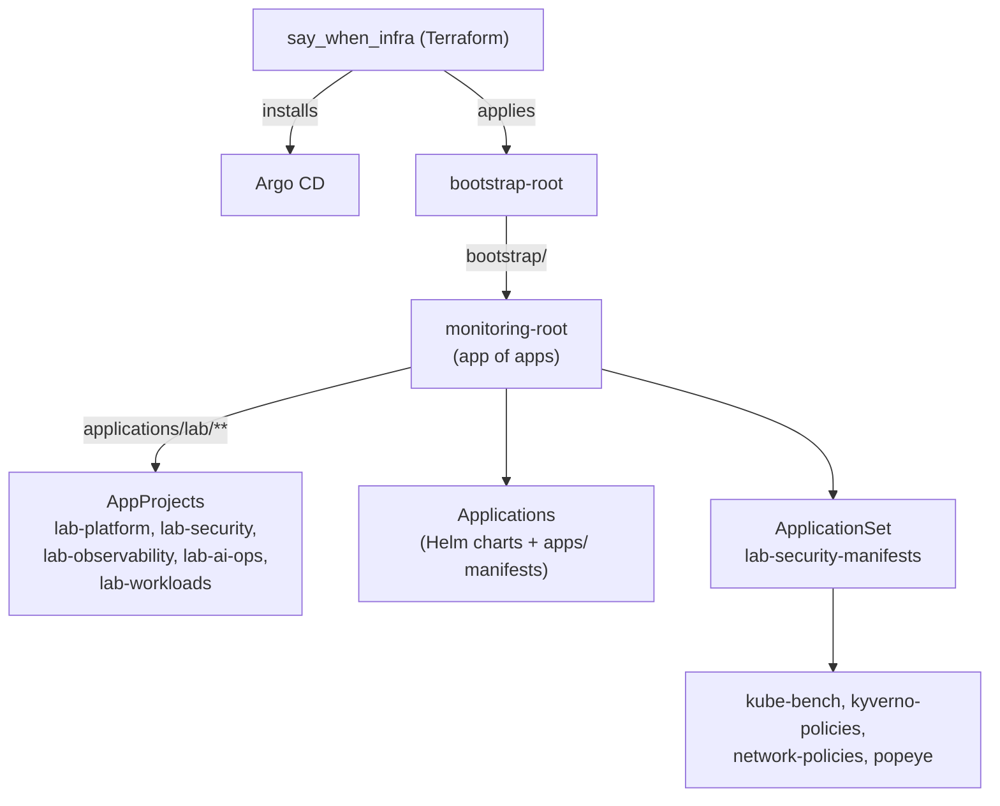
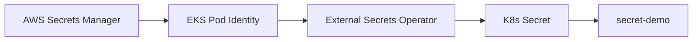

# Say When: EKS GitOps Platform 🤠

The GitOps half of my AWS EKS DevSecOps home lab. Argo CD watches this repo and makes the cluster match it: security tooling, observability, autoscaling, ingress, progressive delivery, AI ops and demo workloads.

| | |
| --- | --- |
| 🏗️ AWS infrastructure (VPC, EKS, IAM, Argo CD install) | [say_when_infra](https://github.com/earpjennings37/say_when_infra) |
| 📖 Walkthroughs, screenshots and lessons learned | [I'm Your Huckleberry](https://im-your-huckleberry.com/) |
| 🧾 Commands from each blog post | [say_when_blog](https://github.com/earpjennings37/say_when_blog) |

> If you're more of a "lemme see the sausage being made" person, this is the place. Everything that runs in the cluster is defined here.

Now I know what you're thinking: what will this repo and blog actually do for me? Well, as some great 21st-century philosophers before me once said:

- Wyatt Earp: *"You tell 'em I'm coming, and hell's coming with me!"*
- Matt Foley: *"I'm gonna be your shadow! We're gonna be pals! We're gonna wrestle around with each other!"*
- Bane: *"I was born in the dark..."*
- Justin Gaethje: *"People recognize max effort."*

## How it fits together



1. Terraform creates the cluster, installs Argo CD and applies `bootstrap-root`.
2. `bootstrap-root` syncs `bootstrap/`, which creates `monitoring-root`.
3. `monitoring-root` recursively syncs everything under `applications/lab/`. Despite the name, it manages **every** category, not just monitoring.
4. Each Application deploys either a pinned Helm chart (with values from `apps/<name>/values.yaml`) or plain manifests from `apps/<name>/`.
5. Everything auto-syncs with `prune: true` and `selfHeal: true`, so Git is the source of truth. Change something by hand and Argo CD puts it back.

**Rule of thumb:** `applications/` decides *what* gets deployed and `apps/` holds *how* it's configured.

## What's running

| Category | AppProject | Component | Chart / source | Version |
| --- | --- | --- | --- | --- |
| Platform | `lab-platform` | Karpenter (CRDs + controller) | `public.ecr.aws/karpenter` | 1.14.1 |
| | | Karpenter `EC2NodeClass` + `NodePool` | `apps/karpenter-config` | |
| | | Envoy Gateway (Gateway API CRDs + controller) | `docker.io/envoyproxy` | v1.6.7 |
| | | Envoy Gateway `GatewayClass` / `Gateway` | `apps/envoy-gateway-config` | |
| | | Argo Rollouts | `argo-rollouts` | 2.43.11 |
| | | Metrics Server | `metrics-server` | 3.12.0 |
| | `default` | gp3 `StorageClass`, `monitoring` namespace | `applications/lab/platform` | |
| Security | `lab-security` | Kyverno + 8 CEL policies | `kyverno` | 3.9.1 |
| | | Falco | `falco` | 9.1.0 |
| | | Trivy Operator | `trivy-operator` | 0.35.0 |
| | | External Secrets Operator | `external-secrets` | 2.12.0 |
| | | kube-bench, Popeye, network policies | ApplicationSet → `apps/` | |
| Observability | `lab-observability` | kube-prometheus-stack (Prometheus + Grafana) | `kube-prometheus-stack` | 87.21.0 |
| | | Thanos | `bitnamicharts/thanos` (OCI) | 17.3.1 |
| | | Loki | `loki` | 6.6.2 |
| | | Tempo | `tempo` | 1.7.0 |
| AI ops | `lab-ai-ops` | K8sGPT operator + `K8sGPT` (Bedrock, Nova Lite) | `k8sgpt-operator` | 0.2.29 |
| Workloads | `lab-workloads` | `secret-demo` + its `SecretStore`/`ExternalSecret` | `apps/secret-demo`, `apps/external-secrets-config` | |
| | | `gateway-demo` (whoami behind an `HTTPRoute`) | `apps/gateway-demo` | |
| | | `rollouts-demo` (canary) | `apps/rollouts-demo` | |
| | | `rollouts-bluegreen` (blue-green, manual promotion) | `apps/rollouts-bluegreen` | |

Only `bootstrap-root` and `monitoring-root` (plus the two cluster-foundation manifests) should live in the `default` project. Everything else goes in a `lab-*` AppProject that limits which repos, namespaces and resource kinds it can touch.

## Sync order

Applications use `argocd.argoproj.io/sync-wave` so dependencies come up first:

| Wave | Applications |
| --- | --- |
| `-2` | `karpenter-crd`, `envoy-gateway` (CRDs) |
| `-1` | `karpenter`, `argo-rollouts` |
| `0` | `karpenter-config`, `envoy-gateway-config`, `external-secrets`, `kyverno`, `k8sgpt-operator` |
| `1` | `external-secrets-config`, `gateway-demo`, `rollouts-bluegreen`, `k8sgpt` |
| `2` | `secret-demo` |
| none (0) | `rollouts-demo` and everything else |

> ℹ️ Waves currently control the **order** Applications start in, not whether the previous wave is healthy. To make Argo CD wait on child Application health, add a health check for `argoproj.io/Application` to the Argo CD values in `say_when_infra`. That isn't set up yet.

## Repository structure

```text
.
├── bootstrap/                     # Applied by Terraform: bootstrap-root → monitoring-root
├── applications/lab/              # Argo CD objects: what gets deployed
│   ├── projects/                  #   AppProjects (guardrails)
│   ├── platform/                  #   Karpenter, Envoy Gateway, Rollouts, metrics-server, storage
│   ├── security/                  #   Kyverno, Falco, Trivy, ESO + the security ApplicationSet
│   ├── observability/             #   Prometheus/Grafana, Thanos, Loki, Tempo
│   ├── ai-ops/                    #   K8sGPT operator + K8sGPT resource
│   └── workloads/                 #   Demo apps
├── apps/                          # Helm values + raw manifests: how it's configured
│   ├── <chart>/values.yaml
│   ├── kyverno/policies/          #   8 CEL policies
│   ├── network-policies/          #   default-deny + allow rules for monitoring
│   ├── karpenter-config/          #   EC2NodeClass + NodePool
│   ├── envoy-gateway-config/      #   GatewayClass, Gateway, EnvoyProxy
│   ├── rollouts-demo/  rollouts-bluegreen/  gateway-demo/  secret-demo/
│   └── kube-bench/  popeye/  k8sgpt/  external-secrets-config/
├── docs/kubectl-ai/               # Example local kubectl-ai config (no credentials)
├── .github/workflows/             # CI: yamllint, helm template, kubeconform, Trivy
└── .yamllint.yaml
```

## Values that must match Terraform

A few settings here point at AWS resources that `say_when_infra` creates. If you fork this or rename things, change both sides:

| Here | Must match | Terraform source |
| --- | --- | --- |
| `apps/karpenter/values.yaml` `clusterName: say-when-east`, `interruptionQueue: Karpenter-say-when-east` | Cluster name + SQS queue | `locals.tf`, `karpenter.tf` |
| `apps/karpenter-config/ec2nodeclass.yaml` `instanceProfile`, `karpenter.sh/discovery` tags | Instance profile + subnet/SG tags | `karpenter.tf`, `vpc.tf`, `eks.tf` |
| `apps/thanos/values.yaml`, `apps/kube-prometheus-stack/manifests/thanos-objstore-secret.yaml` bucket `thanos-infinity-37` | Thanos bucket | `bucket_name` variable |
| `apps/k8sgpt/k8sgpt.yaml` `serviceAccountIRSA` role ARN | K8sGPT IRSA role | `k8sgpt-iam.tf` |
| `apps/popeye/cronjob.yaml` image | Popeye ECR repo | `ecr-popeye.tf` |
| `apps/external-secrets-config/external-secret.yaml` key `say-when/demo-app/credentials` | Secrets Manager secret | `external-secrets.tf` |

The Thanos `objstore` Secret holds only the bucket name and region. Access comes from IRSA, not keys.

## Highlights

### External Secrets

Terraform owns the AWS secret, IAM role and Pod Identity association. Argo CD owns the operator, `SecretStore` and `ExternalSecret`. The demo app only ever sees a normal Kubernetes Secret and has no AWS permissions.

### Kyverno policies
| Policy | Mode |
| --- | --- |
| Disallow `latest` / untagged images | **Deny** |
| Disallow privilege escalation | **Deny** |
| Disallow privileged containers | Audit |
| Disallow host namespaces | Audit |
| Require app labels | Audit |
| Require requests and limits | Audit |
| Require non-root | Audit |
| Require dropping all capabilities | Audit |

New policies start in Audit until I'm sure they won't break something, then move to Deny.

### Network policies
The `monitoring` namespace is **default-deny**. Only these paths are open: Grafana → Prometheus, Loki and Tempo; Prometheus internal scrapes, kube-state-metrics and node-exporter; Thanos Query → sidecar and store gateway; Loki internal; DNS; and the Kubernetes API where needed. Enforcement comes from the VPC CNI's network policy support, which Terraform turns on.

### Karpenter
One `NodePool` (`lab-arm64-spot`): ARM64 Spot only, `t`/`c`/`m` families, generation 4 and newer, 2–4 vCPU instances, capped at 8 vCPU / 32 GiB total, and it consolidates empty or underused nodes after 5 minutes. Nodes use a pinned AL2023 AMI (`al2023@v20261012`) with IMDSv2 required and encrypted gp3 root volumes.

### Envoy Gateway and Argo Rollouts
- **Gateway API:** Envoy Gateway serves a ClusterIP `Gateway` on port 80. `gateway-demo` attaches an `HTTPRoute` to it. No public load balancer.
- **Canary (`rollouts-demo`):** 20% → manual approval → 40% → 60% → … with short pauses between steps.
- **Blue-green (`rollouts-bluegreen`):** active and preview Services, and auto-promotion turned **off**, so you promote it yourself.

```bash
kubectl argo rollouts get rollout rollouts-demo -n rollouts-demo --watch
kubectl argo rollouts promote rollouts-demo -n rollouts-demo
```

### Observability, sized for a lab
One Prometheus replica with 24h / 1 GB local retention on a 2 Gi gp3 volume, with Thanos sidecar → S3 for longer history. Thanos Store Gateway is on and Compactor is off. Loki runs as a single binary, Tempo uses ephemeral storage, Alertmanager is off, and every service is ClusterIP.

> EBS volumes are tied to one Availability Zone. If Spot takes away every node in that AZ, a stateful pod may show `volume node affinity conflict` until a node comes back there.

## CI

`.github/workflows/gitops-validate.yaml` runs on every PR and every push to `main`:

| Job | What it checks |
| --- | --- |
| yamllint | YAML style and syntax (`.yamllint.yaml`) |
| Helm render | `helm template` for every chart at its pinned version, with these values |
| Helm OCI render | Same for Karpenter, Envoy Gateway and Thanos (OCI charts) |
| kubeconform | Kubernetes schemas for raw manifests (strict) |
| Trivy | Misconfig scan for HIGH/CRITICAL issues. Only reports for now. |

Render and schema checks target the same Kubernetes version as the cluster (`cluster_version` in `say_when_infra`). Bump them together.

## Validate a running cluster

```bash
# Every app, its project and status
kubectl get applications -n argocd \
  -o custom-columns='NAME:.metadata.name,PROJECT:.spec.project,SYNC:.status.sync.status,HEALTH:.status.health.status' | sort

# Projects and ApplicationSets
kubectl get appprojects,applicationsets -n argocd

# Karpenter
kubectl get nodepools,ec2nodeclasses,nodeclaims

# External Secrets
kubectl get secretstore,externalsecret -n secret-demo

# Gateway API
kubectl get gatewayclass,gateway -A && kubectl get httproute -A

# Monitoring + metrics
kubectl get pods -n monitoring
kubectl top nodes
```

## Rebuilding the lab

1. `terraform apply` in [say_when_infra](https://github.com/earpjennings37/say_when_infra).
2. Wait for Argo CD, then check that `bootstrap-root` and `monitoring-root` are `Synced/Healthy`.
3. Create the Grafana admin secret (see the infra README; it isn't stored in Git).
4. Wait for every Application to reach `Synced/Healthy`, then run the checks above.
5. When you're done, `terraform destroy`. Nothing here keeps costing money once the cluster is gone, apart from S3 data and ECR images.

Only turn off pruning temporarily, for example while moving a resource from one Application to another.

## Security notes

Not committed here: AWS keys, Bedrock credentials, app passwords, private keys, Terraform state, real Secrets or kubeconfigs. AWS access comes from IRSA and Pod Identity.

The account ID, role ARNs and bucket name in this repo are identifiers, not credentials. If you reuse this, parameterize them.

## Local AI tooling

K8sGPT runs **in** the cluster and calls Bedrock through IRSA. `kubectl-ai` runs on my laptop. There's an example config in `docs/kubectl-ai/config.example.yaml` (no credentials in it).

## Disclaimer

This is a learning and portfolio environment. Running it in production would need, at minimum: high availability, tested backups and DR, central IAM, secret rotation, private networking, admission-policy testing, real alerting, supply-chain verification and change management.
